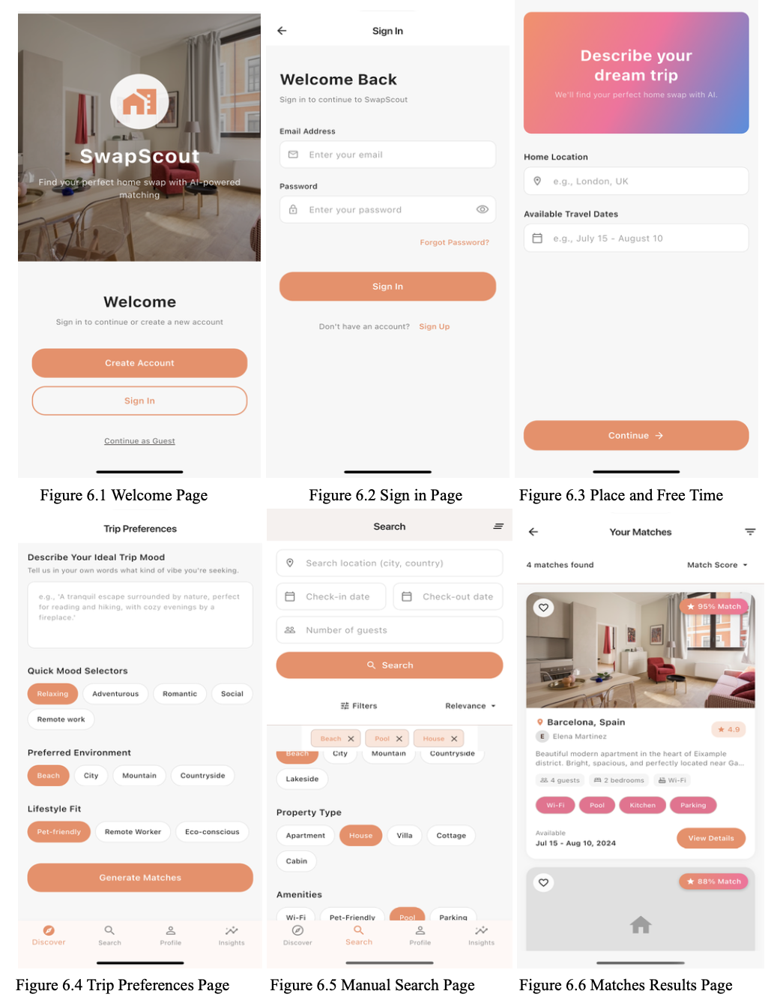
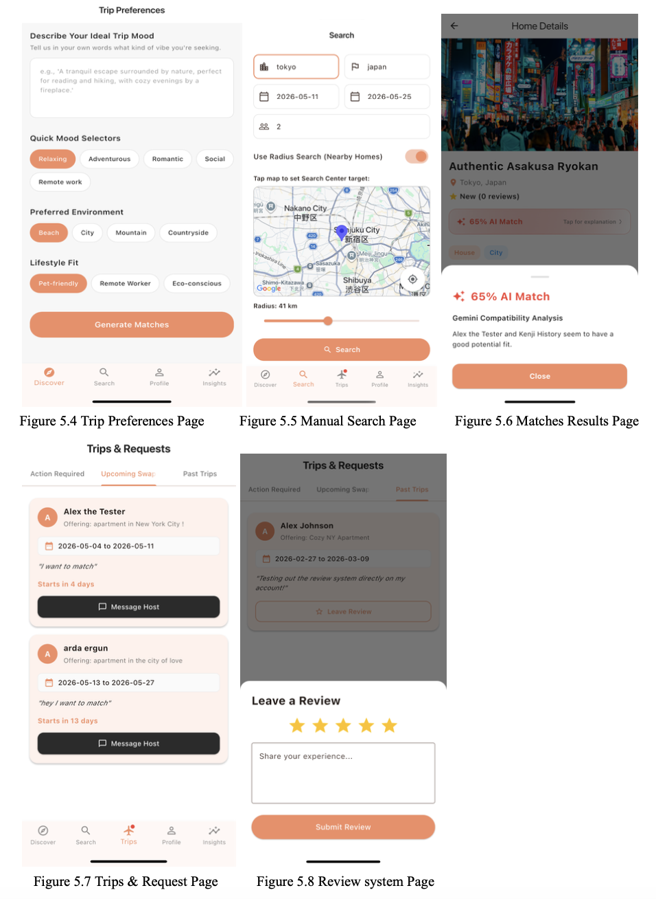

# SwapScout

**AI-assisted home exchange and travel discovery platform**

SwapScout is a cross-platform application for people who want to discover homes that fit their trip preferences and arrange home exchanges with other travelers. The project was developed as a computer engineering graduation project.

> **Project status:** Graduation-project prototype. The repository contains a Flutter client and a FastAPI backend. Running the complete app requires a PostgreSQL database and configuration for any external services you use. It is not a one-click hosted demo.

## What it does

- Create an account, sign in, and manage a traveler profile.
- Create and browse home listings, including amenities, location, capacity, and availability.
- Save trip preferences and search for homes that fit a trip.
- Generate compatibility scores and explanations with rule-based matching and Google Gemini integration.
- Send and manage home-swap requests, with date availability checks.
- Message other users and receive activity updates, including WebSocket-based notifications.
- Save favorite homes and review completed exchanges.
- Use map and location features through Google Maps integrations in the Flutter client.

## Screenshots

### Welcome, sign-in, trip preferences, and home matches



### Search, AI match explanation, trips, and reviews



## Technology

| Component | Technologies |
| --- | --- |
| Mobile and web client | Flutter, Dart |
| Backend API | Python, FastAPI, Uvicorn, Pydantic |
| Persistence | PostgreSQL, SQLAlchemy |
| Authentication | JWT bearer tokens, password hashing |
| Real-time updates | WebSockets |
| AI integration | Google Gemini API |
| Maps and geocoding | Google Maps Flutter, Geolocator, Geocoding |
| Image support | PostgreSQL image data and Firebase Storage integration |

## How it is organized

```text
.
├── lib/                 # Flutter application source
├── android/             # Android project
├── ios/                 # iOS project
├── web/                 # Flutter web target
├── test/                # Flutter tests
├── integration_test/    # Flutter integration tests
└── swapscout_api/       # FastAPI backend
    ├── endpoints/       # API routes
    ├── schemas/         # Request and response models
    ├── services/        # Application and integration logic
    └── utils/           # Authentication and service helpers
```

## Run locally

### Requirements

- Flutter SDK compatible with the version declared in `pubspec.yaml`.
- Python 3 and PostgreSQL.
- A Google Gemini API key for Gemini-backed functionality.
- Firebase credentials if using the Firebase image-upload flow.
- Google Maps configuration for map features.

### 1. Configure the backend

Create a local PostgreSQL database, then update the database connection in `swapscout_api/database.py` to match your local PostgreSQL user and database.

From the repository root:

```bash
cd swapscout_api
python3 -m venv .venv
source .venv/bin/activate
pip install fastapi uvicorn sqlalchemy psycopg2-binary pydantic email-validator python-jose passlib python-multipart Pillow firebase-admin google-generativeai
```

Set the Gemini key in your shell if you plan to use Gemini-backed features:

```bash
export GEMINI_API_KEY="your-gemini-api-key"
```

The Firebase setup currently expects a service-account JSON file. Keep that credential outside version control and configure the backend to read it securely. Do not commit API keys, service-account files, database passwords, or production tokens.

Start the API from the `swapscout_api` directory:

```bash
uvicorn main:app --reload --host 0.0.0.0 --port 8000
```

The API root is available at `http://localhost:8000` and the interactive API reference at `http://localhost:8000/docs`.

### 2. Run the Flutter app

In a second terminal, from the repository root:

```bash
flutter pub get
flutter run
```

The API address is currently selected in `lib/services/api_client.dart` for local development: Android emulators use `10.0.2.2`, while web and other platforms use `127.0.0.1`. For a physical phone, change the address to your development computer's LAN IP and make sure both devices can reach it.

## Configuration and deployment notes

- The current database connection is configured directly in `swapscout_api/database.py`; use a private environment-based configuration before deploying.
- `GEMINI_API_KEY` is read from the environment. Review all service credentials and replace development values before hosting the API.
- The app's API base URL is set in `lib/services/api_client.dart`. A deployed app needs the HTTPS URL of its deployed backend.
- The backend allows broad CORS origins in its current configuration. Restrict this for a public deployment.
- Hosting the Flutter web build alone does not host the API or PostgreSQL database. A complete deployment needs hosting for the backend and database, plus secure configuration for external services.

## Security

Never publish secrets in source code, `.env` files, or Firebase service-account JSON files. If a credential was committed or pushed, revoke or rotate it with the service provider before using it again. Keep local virtual environments and generated build files out of Git.

## Project background

SwapScout was designed as a client-server home-exchange system. The submitted software design and test documents describe the intended requirements, architecture, and verification plan; the running code may differ from those documents as the implementation evolves.
